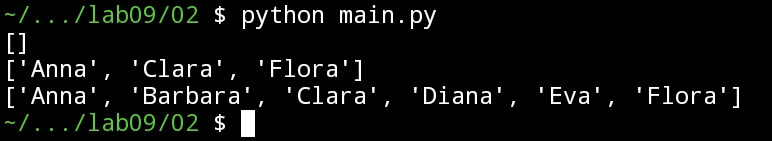
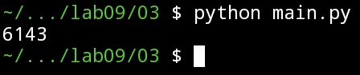
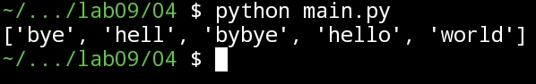
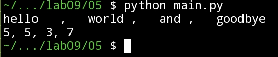
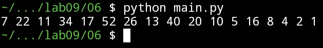
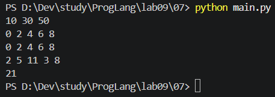
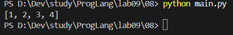

# Языки программирования

## Лабораторная работа 9

### Задание 1 **(2)**

_Рассмотрим следующую программу._

```
d = {'sep': ',' , 'end': '\n'}
l = ['Утопия', 14, 'Вселенная', 25]
print (l, d)
print (*l, d)
print (*l, *d)
print (*l, **d)
```

_Объясните результаты ее работы._

_При устном ответе на вопросы вам потребуется рассказать, что такое "Утопия 14" и "Вселенная 25"._

### Задание 2 **(2)**

_Напишите функцию_ **sublist** для решения следующей задачи.\*

_На вход функции поступает список или кортеж и набор номеров позиций.
Функция должна составить и вернуть список из элементов, которые
находятся на этих позициях. Примеры работы приводятся ниже. Работа функции должна строго им соответствовать._

```
>>> lst = [ 'Anna', 'Barbara', 'Clara', 'Diana', 'Eva', 'Flora']
>>> sublist(lst, 0, 2, 5)
['Anna', 'Clara', 'Flora']
>>> sublist (lst)
[]
>>> sublist(lst, 0, 1, 2, 3, 4, 5)
['Anna', 'Barbara', 'Clara', 'Diana', 'Eva', 'Flora']
```

**Ответ**:

```
def sublist(lst, *nums):
	l = []
	for id in nums:
		l.append(lst[id])

	print(l)
lst = [ 'Anna', 'Barbara', 'Clara', 'Diana', 'Eva', 'Flora']
sublist(lst)
sublist(lst, 0, 2, 5)
sublist(lst, 0, 1, 2, 3, 4, 5)
```



### Задание 3 **(1)**

_Задан список_ **lst** _из натуральных чисел_. _Напишите фрагмент
программы, состоящий из одного вызова функции_ **max**, _который найдет в этом списке число с максимальным
числом единиц в двоичной записи._

_Многоточие надо заменить на лямбда-функцию, использующую фукцию_ **bin** _и метод строк_ **count**.

_Пример работы приводится ниже._

```
>>> lst = list(range(6000 ,7000))
>>> ans = max(lst,...)
>>> print(ans)
6143
```

**Ответ**:

```
lst = list(range(6000, 7000))
ans = max(lst, key=lambda n: bin(n).count("1"))
print(ans)
```



### Задание 4 **(2)**

_Запишите фрагмент программы, которая упорядочит список слов
по длине, а при равенстве длины - лексикографически. Сортировка
должна состоять из одного вызова метода_ **sort**.

_Пример работы приводится ниже._

```
>>> lst = ['hello', 'hell', 'bye', 'world', 'bybye']
>>> lst.sort (...)
>>> print (lst)
['bye', 'hell', 'babye', 'hello', 'world']
```

**Ответ**:

```
lst = ['hello', 'hell', 'bye', 'world', 'bybye']
lst.sort(key= lambda n: (len(n), n))
print (lst)
```



### Задание 5 **(2)**

_Напишите программу для решения следующей задачи._

_В одной строке через запятую записана последовательность слов. Перед
запятой или после нее могут быть пробелы, сами слова пробелов не
содержат. Программа должна вывести в одной строке через запятую
последовательность чисел, равных длине каждого слова. Например,
для ввода_

```
hello   ,   world ,   and ,   goodbye
```

_программа должна вывести_

```
5, 5, 3, 7
```

_Программа должна быть написана с использованием парадигмы функционального программирования, то есть без использования циклов, присваиваний и т.д. Программа может использовать функции_ **input**, **print**, **len**, **map** _и методы строк_ **split** и **strip**.  
**Ответ**:

```
lst = list(map(lambda n: str(len(n.strip())), input().split(",")))
print(", ".join(lst))
```



### Задание 6 **(2)**

_Запишите генератор в форме функции, который будет создавать
последовательность по следующему правилу._

- _Если текущее число x в последовательности четное, то следующее число равно x/2._
- _Иначе следующее число равно 3x + 1._

_Последовательность начинается с заданного числа n и заканчивается единицей._

_Далее приведен пример работы генератора._

```
>>> print (*gen(7))
7 22 11 34 17 52 26 13 40 20 10 5 16 8 4 2 1
```

**Ответ**:

```
def gen(n):
    while n > 1:
        yield n
        if n % 2 == 0:
            n //= 2
        else:
            n = 3 * n + 1
    yield 1
print(*gen(7))
```



### Задание 7 **(2)**

_Напишите генератор, который для заданной последовательности_
**seq** _будет задавать последовательность из каждого второго элемента_ **seq**.

```
def every_other(seq):
    ...
```

_Ниже приведены примеры использования генератра._

```
>>> print (*every_other([10, 20, 30, 40, 50]))
10 30 50
>>> print(*every_other(range(10)))
0 2 4 6 8
>>> print(*every_other(iter(range(10))))
0 2 4 6 8
>>> print(sum(every_other(map(int, input().split()))))
2 5 11 3 8
21
```

**Ответ**:

```
def every_other(seq):
    i = 0
    for n in seq:
        if i % 2 == 0:
            yield n
        i += 1
print(*every_other([10, 20, 30, 40, 50]))
print(*every_other(range(10)))
print(*every_other(iter(range(10))))
print(sum(every_other(map(int, input().split()))))

```



### Задание 8 **(2)**

_Задан список_ **lst**, _в котором записаны вперемешку числа и строки._.
_Напишите фрагмент программы, состоящий из одного конструктора списков, который построит новый список, состоящий только из чисел._

_Определить тип объекта в Python можно с использованием функции_ **type**.

_Пример работы приводится ниже._

```
>>> lst = [1,'abc', 2, 3, 4, 'aa']
>>> nums = [...]
>>> print(nums)
[1, 2, 3, 4]
```

**Ответ**:

```
lst = [1,'abc', 2, 3, 4, 'aa']
nums = [n for n in lst if type(n) is int]
print(nums)
```



### Задание 9 **(2)**

_Напишите фрагмент программы, состоящий из одного конструктора списков, который построит двумерный список в виде таблицы умножения размера_
**n×n**.

_Пример работы приводится ниже._

```
>>> n = 5
>>> tblmul = [...]
>>> print(*tblmul,sep='\n')
[1, 2, 3, 4, 5]
[2, 4, 6, 8, 10]
[3, 6, 9, 12, 15]
[4, 8, 12, 16, 20]
[5, 10, 15, 20, 25]
```

### Задание 10 **(1)**

_Какие из указанных функций и методов Python соответствуют определению чистых функций?
В случае отрицательного ответа требуется дать пояснение._

- **file.readline|** — _чтение строки из файла._
- **len** — _определение длины строки или количества элементов в контейнере._
- **list.append** — _добавление в список нового элемента._
- **sum** — _нахождение суммы._
- **sorted** — _построение сортированного списка._
- **list.sort** — _сортировка списка._
- **random.randint** — _генерация случайного целого числа._
- _Разворот списка._

```
def rev(x):
    return x[::-1]
```

- _Выбор нескольких элементов из хвоста списка._

```
tail_len = 3
def tail(x):
    return x[-tail_len:]
```

### Задание 11 **(2)**

_Рассмотрите следующую функцию._

```
def toint(fun):
    def wrapper(*args):
        return fun(*map(int, args))
    return wrapper
```

_Что передается в функцию_ **toint**? _Что возвращает эта функция?_
_Что делает функция_ **wrapper**?
_Придумайте несколько примеров использования_ **toint**.

## Дополнительные задания

### Задание 1 **(3)**

_Самостоятельно познакомьтесь с понятием декораторов в Python. Приведите примеры использования
функции_ **toint** _из задания выше в качестве декоратора._

### Задание 2 **(3)**

_Напишите фрагмент программы, которая найдет в списке слов слово с максимальной длиной. При равенстве длин
найдет самое первое в лексикографическом порядке._

_Фрагмент программы должен состоять из одного вызова функции_ **min** _или_ **max**.

### Задание 3 **(5)**

_Напишите рекурсивную функцию для нахождения_ **n**-о _числа Фибоначчи._

_Функция обязательно должна работать с достаточно большими числами, например_ **n = 1000** _и не
должна использовать библиотечные функции и методы._

### Задание 4 **(9)**

_Напишите функцию_ **fastpow**, _которая будет создавать лямбда-функцию для быстрого
возведения в фиксированную степень_ **n**. _Например, должен работать следующий код_

```
>>> pow10 = fastpow(10)
>>> print(pow10(2))
1024
```

_Функция_ **fastpow** _в этом примере должна строить выражение для быстрого возведения в степень
по стандартному алгоритму_

- **x^1 = x**;
- **x^{2n} = (x^n) ** 2\*\*;
- **x^{2n+1}=x\*x^{2n}**;

_Например,
для_ **n = 10** _может быть получена подобная строка_ `(x*((x**2)**2))**2`.

_Далее_ **fastpow** _будет возвращать лямбда функцию_

```
lambda x: eval(s)
```

_При написании функции_ **fastpow** _можно использовать вспомогательные функции._
