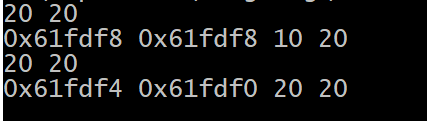
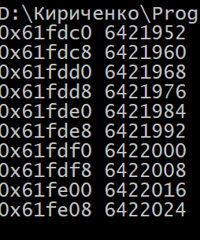
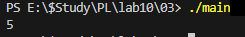
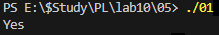
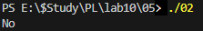
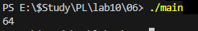
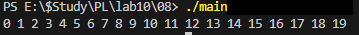
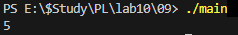
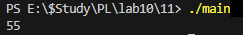

# Языки программирования ## Лабораторная работа 10

### Задание 1 **(2)**

*Рассмотрите следующие фрагменты программ. Запишите, что означают символы* **&** и  * *в каждом случае применения.*
```
int a = 10, b = 20;
int *p = &a , *q = &b;
p = q;
std::cout << *p <<' '<< *q << std::endl;
```
```
int a = 10, b = 20;
int *p = &a , *q = &b;
*p = *q;
std::cout << *p <<' '<< *q << std::endl;
```
*Чем различаются присваивания в третьей строке? Что можно вывести,
чтобы показать различия?*

*Примеры программ сохраните в папке с номером задания. Скриншоты работы прикрепите к отчету.*

  
  
В первой программе int *p создает указатель, а &a берет адрес переменной a. Строка p = q; копирует сам адрес, поэтому p начинает смотреть на b. При выводе *p и *q оба указателя берут значение из b, поэтому печатается 20 20.
Во второй программе *p = *q; копирует само значение: число из b записывается в a. Сами указатели никуда не сдвигаются. В итоге a становится равно 20, но p по-прежнему смотрит на a, а q - на b.
Чтобы показать разницу, можно вывести адреса p, q и значения a, b: в первом случае совпадут адреса, а во втором - значения переменных.
  
### Задание 2 **(1)**

*Рассмотрим следующую программу.* 
```
double x[10];
for (int i = 0; i <10; i++)
    std::cout << &x[i] << std::endl;
```
*Что она выводит? Измените
вывод так, чтобы адреса выводились в десятичной системе счисления.
Объясните почему числа составляют арифметическую прогрессию с
определенным шагом.*

*Записанную программу сохраните в папке с номером задания.*
*Скриншоты работы прикрепите к отчету.*  

  

Программа выводит адреса элементов массива в шестнадцатеричном формате. Чтобы получить их в привычном десятичном виде, адрес нужно привести к целому числу через reinterpret_cast<size_t>(&x[i]).
Адреса образуют арифметическую прогрессию, т. к. элементы массива лежат в памяти строго подряд. Шаг этой прогрессии равен размеру одного элемента - sizeof(double), то есть 8 байт.  

### Задание 3 **(2)**

*Токен* **«*»** *в языке C++ может использоваться в трех различных
случаях. Аналогично токен* **«&»** *также может использоваться в трех
случаях. Приведите пример одной программы в которой они были бы
использованы во всех случаях.*

*Записанную программу сохраните в папке с номером задания.*



**Токен `*` используется в**
* Умножении
* Объявлении указателя
* Разыменовании

**Токен `&` используется в**
* Побитовом И
* Взятии адреса
* Объявлении ссылки

### Задание 4 **(2)**

*Выпишите значения всех переменных, в том числе указателей,
после выполнения каждой инструкции программы. Объясните, что
происходит в результате выполнения каждой инструкции.*
```
unsigned a = 8, b = 3 ,c = 17;
unsigned *p = &a;
unsigned *q = &b;
*p += *q + c;
c = *q;
p = &c;
c += a;
*p += 10;
*q = *p;
q = p ;
*q += 10;
```

Объяснение:
- `*p += *q + c;` - к значению `a` суммируются значения `b` и `c`
- `c = *q;` - в `c` копируется значение `b`.
- `p = &c;` - `p` теперь указывает на `c`.
- `c += a;` - к `c` прибавляется `a`.
- `*p += 10;` - увеличивается значение по адресу `p`, т. е. `c`.
- `*q = *p;` - значение `c` записывается в `b`.
- `q = p;` - `q` начинает указывать туда же, куда `p` (на `c`).
- `*q += 10;` - снова увеличивается `c`.

### Задание 5 **(1)**

*Что сравнивается в приведенной ниже программе? Как можно
изменить первую строчку программы, чтобы результат тоже
изменился?*
```
int x = 1, y = 2;
int *p = &y, *q = &x;
if (p < q)
    std::cout << "Yes";
else
    std::cout << "No";
```

Программа сравнивает сами адреса указателей в условии if, а не значения внутри переменных. Расположение адресов в памяти зависит от того, какая переменная объявлена первой. Поэтому при смене порядка создания x и y вывод программы меняется, независимо от хранящихся в них данных.  

Вывод при создании сначала x, потом y  

Вывод при создании сначала x, потом x  


### Задание 6 **(2)**

*Объясните работу следующей программы. Как изменится
результат, если тип* **double** *изменить на некоторый другой, например*
**int** *или* **char**?
```
double x = 0;
double *d = &x;
std::cout << reinterpret_cast<size_t>(d + 4) - reinterpret_cast<size_t>(d - 4) << std::endl;
```

d это указатель на double, а d + 4 и d - 4 - это адреса элементов со сдвигом на 4 позиции вправо и влево. reinterpret_cast<size_t> превращает адреса в обычные числа, поэтому их разность показывает расстояние в байтах. Между d - 4 и d + 4 помещается 8 элементов по 8 байт (sizeof(double)), итого 8 * 8 = 64.
При замене double на int получится 8 * 4 = 32, а при замене на char - 8 * 1 = 8, т. к. меняется размер одного элемента.


### Задание 7 **(2)**

*Объясните работу следующей программы. Как изменится
результат, если тип* **double** *изменить на некоторый другой, например*
**int** *или* **char**?
```
std::cout << reinterpret_cast <double*>(3000) - reinterpret_cast <double*>(2000) << std::endl;
```

reinterpret_cast<double*>(3000) и reinterpret_cast<double*>(2000) создают указатели с адресами 3000 и 2000. При вычитании указателей разница между ними делится на размер типа, поэтому выходит (3000 - 2000) / sizeof(double) = 1000 / 8 = 125.  
Для int получилось бы 1000 / 4 = 250, а для char - 1000 / 1 = 1000. По стандарту вычитать указатели на разные объекты нельзя (это неопределённое поведение), но на практике компилятор просто делит разность адресов на размер элемента.  

### Задание 8 **(2)**

*Что надо дописать в записанной ниже программе вместо многоточий, чтобы
она выводила все числа из массива* **a**? *Почему?*
```
int a[20];
for ( int i = 0; i < 20; i++)
    a[i] = i;
int *b=a + 8;
for (int i =...; i <...; i++)
    std::cout << b[i] <<' ';
```
  
Нужно написать for (int i = -8; i < 12; i++), т. к. b указывает на a[8]. Чтобы добраться до начала массива a[0], нужен отрицательный индекс -8, а чтобы дойти до конца a[19] - индекс 11 (отсюда условие i < 12). В итоге программа выведет все 20 чисел от 0 до 19.  




### Задание 9 **(2)**

*Что выводит следующая программа? Изменится ли результат если
изменить тип элементов массива?*

```
int a[10];
std::cout << &a[8] - &a[3] << std::endl;
```

Не поменяется, т. к. меняется размер элементов массива, а разница между ними остаётся одинаковой.



### Задание 10 **(1)**

*Есть ли разница между инициализацией* **p** и **q** *в следующей программе? Обоснуйте ответ.*
```
int x [10]={1, 2, 3, 4, 5, 6, 7, 8, 9, 10};
int *p = x + 5;
int *q = &x[5];
```

Нет, т. к. `x + 5` задаёт указатель на 5 элемент, а `&x[5]` делает то же самое.  

### Задание 11 **(3)**

*Указатели можно использовать для итерации по массивам.
Напишите программу, которая найдет сумму элементов массива,
используя указатели. В начале цикла указатель требуется установить
на начало массива, в конце каждой итерации смещать его к
следующему элементу массива через инкремент. Для выхода из цикла
надо проверять, что указатель дошел до конца массива.*
```
int x [10]={1, 2, 3, 4, 5, 6, 7, 8, 9, 10};
int s = 0;
for (int *p = ...; ...; ...)
    s += ...
std::cout << s;
```

*Записанную программу сохраните в папке с номером задания.*

Сумма элементов массива равна 55. Сначала указатель p ставится на первый элемент (x), после каждого шага сдвигается дальше (p++), и так пока не достигнет конца массива на границе x + 10.

